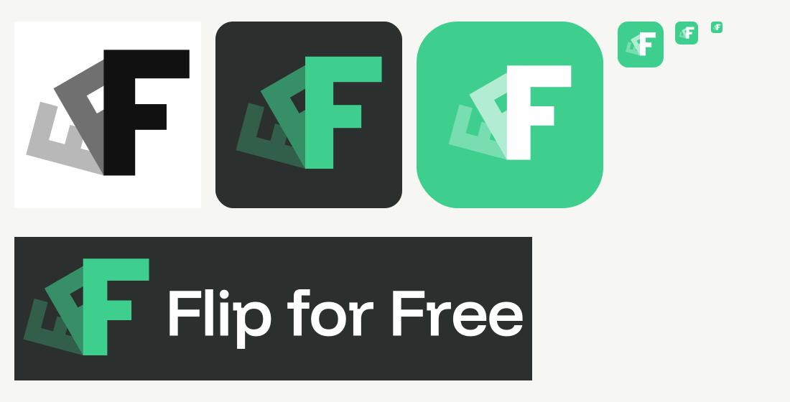

# Flip for Free logo

**The idea:** one F flipping upright, shown in three frames. Each frame is bigger and stronger than the one before it,
and every frame turns about the solid F's bottom-left corner. None of them reaches below the solid F's foot or above its top.

## Colours
| Name | Hex | Use |
|---|---|---|
| Mint | `#3ECF8E` | the mark, buttons, highlights |
| Grey | `#2B2F2D` | the ground in the app's dark mode and on the website |
| Ink | `#1C1F1E` | the name on light grounds |
| Text on mint | `#0D2419` | words on a mint button |

The two lighter Fs are the mint at 60% and 30%. On a known ground (`*-on-grey.svg`, the favicon) they are mixed into
flat colours, so the stronger F hides what lies under it. On an unknown ground use `flip-symbol.svg`, which keeps them
as transparency.

## Files
| File | Use |
|---|---|
| `flip-symbol.svg` | the mark on any ground |
| `flip-symbol-on-grey.svg`, `flip-symbol-on-white.svg` | the mark on its own tile |
| `flip-favicon.svg` | mint rounded square with the Fs in white: browser tabs and app icons |
| `flip-app-icon.svg` | full-bleed square for iOS and Android (they round the corners) |
| `flip-horizontal*.svg` | the mark beside the name (outlined Funnel Display, no font needed) |
| `flip-symbol-black.svg`, `-white.svg`, `-mono-3ecf8e.svg` | one-colour versions |

PNG and ICO icons are in `static/` (favicon.ico, apple-touch-icon.png, icon-192.png, icon-512.png, maskable-512.png).

## Rules
- **Clear space:** keep the height of the F's top arm clear on every side.
- **Smallest size:** 16px for the favicon; 24px for the mark on its own.
- **Grounds:** mint on grey, or white on mint. Mint on white is too faint for text-sized marks; use the black
  version there.
- **Don't:** rotate or recolour the frames, change their order, add shadows, or put the mark on a busy photo.

The name is set in Funnel Display (SIL Open Font License). A trademark search is worth doing before registering the mark.
